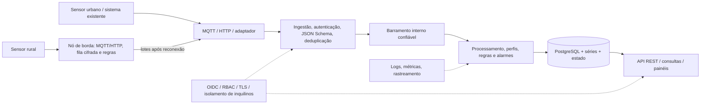

# Arquitetura alvo e vertical slice inicial

## Visão geral pretendida

Esta figura mostra a **arquitetura-alvo**, não o conjunto já implementado pelo kit. O laboratório omite o barramento persistente, OIDC, DLQ, regras completas e muitas demais capacidades.

## Sequência canônica

1. Um dispositivo publica MQTT ou envia HTTP.
2. A plataforma autentica e identifica o inquilino/dispositivo.
3. O sistema valida `versao`, `id_mensagem`, `timestamp`, `medidas` e os demais campos pelo JSON Schema correspondente.
4. Um identificador já processado não produz telemetria em duplicidade.
5. A medição vai ao histórico segundo **instante da medição**, não a data de chegada.
6. O último estado é atualizado **somente se a medição for tão recente quanto a última conhecida**.
7. Regras analisam eventos válidos; dados atrasados não disparam um alarme fingindo que são atuais.
8. API e painéis tornam os dados disponíveis somente a usuários e serviços autorizados.

## Hierarquia de configuração

`Inquilino -> Site -> Área -> Dispositivo`.

Um mesmo modelo configura `coop-cerrado / fazenda-boa-vista / talhao-07 / solo-talhao07-02` e `semma / centro / praca / ar-centro-03`. Os domínios `agricultura`, `ambiente` e `recursos_hidricos` são dados cadastráveis, não nomes presos ao código.

## Modelagem mínima (proposta)

| Entidade | Atributos principais | Comentários |
|---|---|---|
| Inquilino | id, nome | Fronteira de isolamento de dados |
| Domínio | id, inquilino, nome | Criado por configuração |
| Perfil | id, domínio, grandezas, unidades, faixas, intervalo | Contrato de grandezas |
| Site | id, inquilino, nome, geometria | Rural ou urbano |
| Área | id, site, geometria | GeoJSON/PostGIS em etapa posterior |
| Dispositivo | id, inquilino, perfil, site, área, credencial | Credencial por dispositivo |
| Mensagem | id_mensagem UUID, dispositivo, timestamp, payload | Deduplicação e rastreabilidade |
| Medição | id_mensagem, grandeza, valor, unidade | Séries temporais |
| Último estado | dispositivo, grandeza, timestamp, valor | Não sobrepor dado recente por atrasado |
| Regra/alarme | regra, condição, severidade, status, origem | Estados ativo/reconhecido/resolvido |
| Borda/fila | id, mensagem, tentativa, estado de ACK | Persistência e sincronização |

## Uma decisão recomendada de implementação

Começar com **monólito modular de serviços próprios**, definido por fronteiras lógicas e contratos, antes de fragmentar em muitos microsserviços. Infraestruturas especializadas (MQTT, banco, autenticação) ficam em contêineres distintos. Em crescimento, extrair ingestão/regras como serviços independentes usando portas/adaptadores e mensageria. Isso é **uma recomendação para execução didática**, não uma obrigação textual do PDF.

## Camada de borda

A lógica definitiva deve ter fila durável, criptografia em repouso, autenticação própria, backoff, ACK após persistência central, deduplicação, auditoria, métricas de atraso e teste de 72 h sem link. O protótipo usa SQLite com WAL/FULL e reenvio periódico, mas **a fila está em texto claro** e não atende o RF-SEG-05 / RNF-11.
